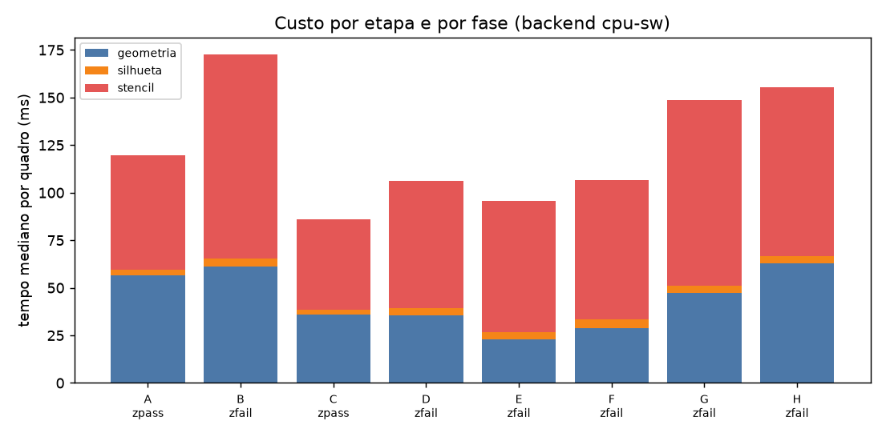
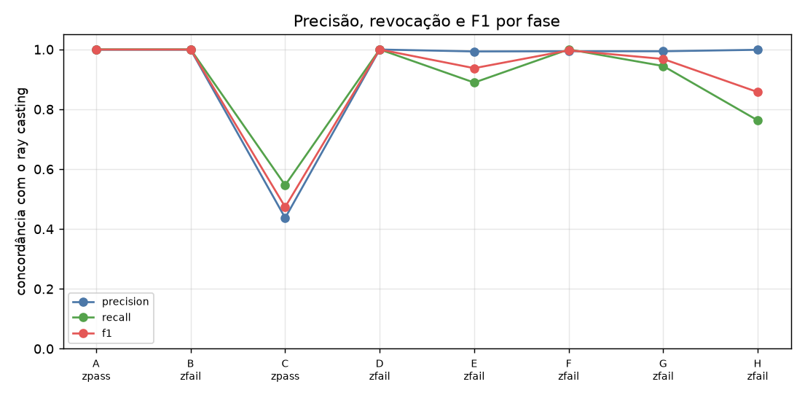
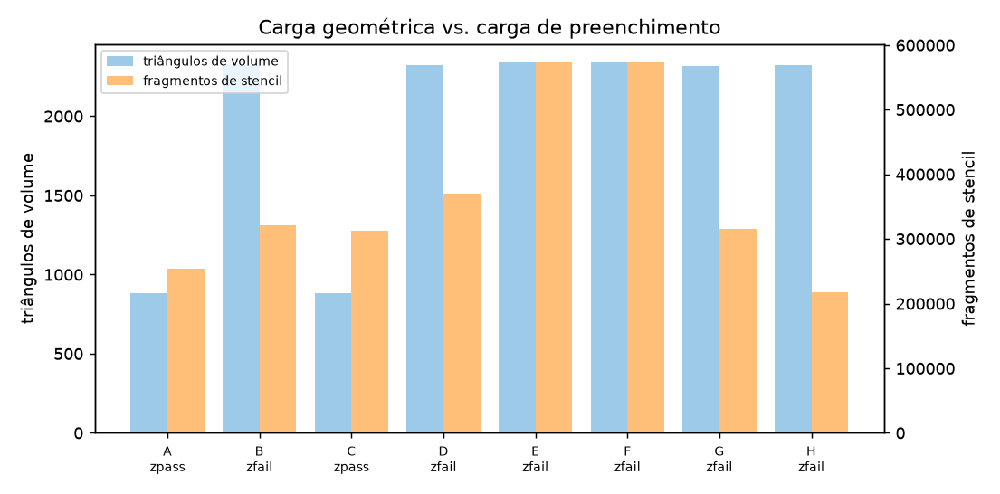
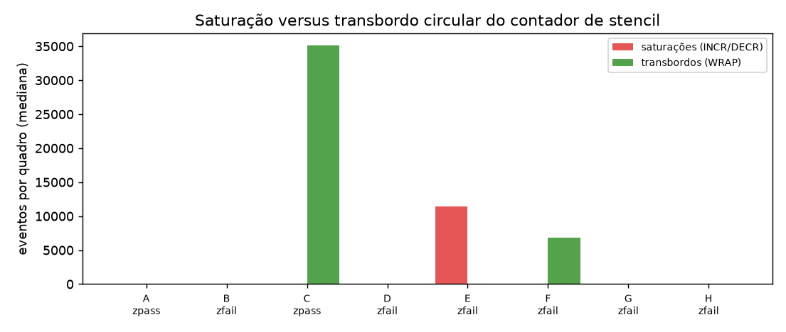
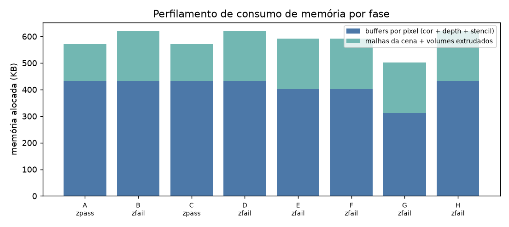
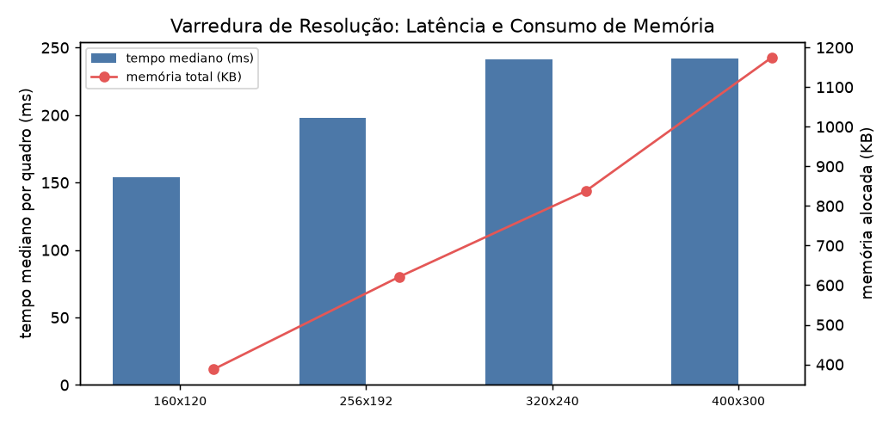
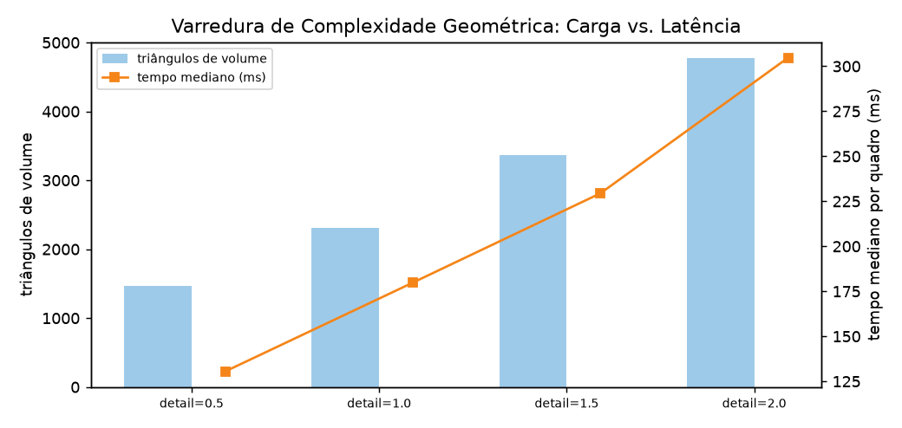
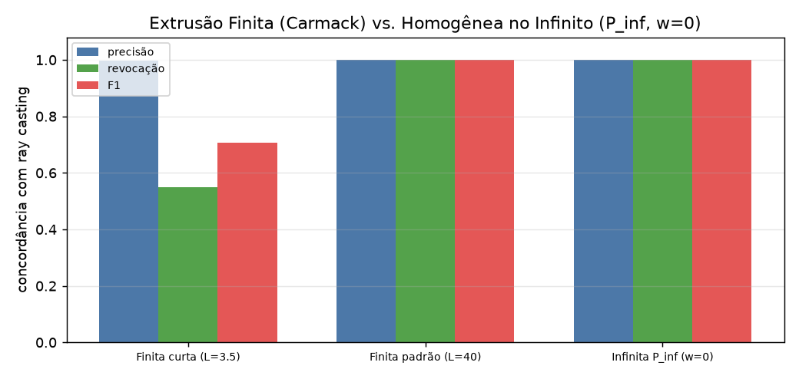

# Relatório Experimental — Sombras Volumétricas por Stencil

Gerado automaticamente em 2026-11-24 16:51. Todos os números abaixo vêm de `experimento.csv` e `resumo.csv`.

> **Backend.** As medições desta sessão foram obtidas no backend `cpu-sw`. O identificador do backend é registrado em cada linha dos CSVs para rastreabilidade.

## 1. Pergunta de pesquisa

Como a arquitetura do buffer (largura do stencil, disponibilidade de operações de transbordo circular `INCR_WRAP`/`DECR_WRAP`, largura do buffer de profundidade e precisão numérica) e a variante do algoritmo (`z-pass` versus `z-fail` com extrusão finita ou homogênea no infinito $P_{\text{inf}}$) afetam a **robustez**, a **precisão geométrica**, o **consumo de memória** e o **custo computacional** da geração de sombras volumétricas?

## 2. Validação do instrumento

A suíte de conformidade do estágio de stencil (OpenGL 1.4, Seção 4.1.5) e da regra de preenchimento top-left registrou **24/24 testes aprovados** (`conformidade.csv`). O rasterizador só é usado como instrumento de medida depois dessa verificação.

## 3. Resultados por fase (Desempenho, Memória e Concordância)

| Fase | Hipótese | Configuração | ms (mediana ± IQR) | Tris volume | Frag. stencil | Memória (KB) | Precisão | Revocação | F1 (± DP) |
|---|---|---|---|---|---|---|---|---|---|
| A — z-pass, câmera externa | H2 | zpass, 8b, wrap=sim, z=0, L=40.0 | 117.1 ± 26.0 | 880 | 254054 | 571.2 | 0.999 | 1.000 | 0.999 ± 0.000 |
| B — z-fail, câmera externa | H2 | zfail, 8b, wrap=sim, z=0, L=40.0 | 172.2 ± 39.7 | 2324 | 321077 | 622.0 | 0.999 | 1.000 | 0.999 ± 0.000 |
| C — z-pass, câmera interna | H1 | zpass, 8b, wrap=sim, z=0, L=40.0 | 86.7 ± 9.1 | 880 | 313160 | 571.2 | 0.437 | 0.547 | 0.474 ± 0.175 |
| D — z-fail, câmera interna | H1 | zfail, 8b, wrap=sim, z=0, L=40.0 | 109.1 ± 14.1 | 2324 | 369837 | 622.0 | 1.000 | 1.000 | 1.000 ± 0.000 |
| E — stencil 3 bits sem wrap | H3 | zfail, 3b, wrap=não, z=0, L=40.0 | 95.9 ± 16.8 | 2340 | 573014 | 592.5 | 0.993 | 0.889 | 0.937 ± 0.036 |
| F — stencil 3 bits com wrap | H3 | zfail, 3b, wrap=sim, z=0, L=40.0 | 105.8 ± 33.8 | 2340 | 573014 | 592.5 | 0.994 | 1.000 | 0.997 ± 0.001 |
| G — profundidade de 12 bits | H4 | zfail, 8b, wrap=sim, z=12, L=40.0 | 150.1 ± 12.7 | 2316 | 315366 | 501.7 | 0.994 | 0.944 | 0.968 ± 0.028 |
| H — extrusão curta | H5 | zfail, 8b, wrap=sim, z=0, L=3.5 | 159.4 ± 27.9 | 2324 | 217841 | 622.0 | 0.999 | 0.763 | 0.857 ± 0.105 |

## 4. Veredicto por hipótese

**H1** — z-pass e z-fail concordam enquanto a câmera está fora dos volumes; a divergência acompanha o número de volumes que contêm a câmera.

> SUSTENTADA pelos dados

**H2** — z-fail custa mais que z-pass por processar e preencher as tampas.

> SUSTENTADA pelos dados

**H3** — sem operações de wrap, a saturação de um stencil estreito produz sombra errada; com wrap, o erro desaparece na mesma cena.

> SUSTENTADA pelos dados

**H4** — reduzir a largura do buffer de profundidade degrada a máscara de sombra de forma distinta da degradação da visibilidade.

> SUSTENTADA pelos dados

**H5** — extrusão finita insuficiente trunca o volume e reduz a revocação, enquanto a extrusão suficiente ou homogênea no infinito (P_inf, w=0) preserva o volume.

> SUSTENTADA pelos dados

Detalhe de H1: F1 de z-pass com a câmera interna = 0.474; z-fail na mesma trajetória = 1.000; volumes contendo a câmera (mediana) = 2.

Detalhe de H3: saturações por quadro sem wrap = 11400 (F1 0.937); com wrap = 6836 transbordos (F1 0.997).

## 5. Análise sob Diferentes Resoluções, Complexidades e Extrusão ($P_{\text{inf}}$)

### 5.1 Varredura de Resolução

| Resolução | ms (mediana ± IQR) | FPS | Frag. stencil | Memória Total (KB) | F1 |
|---|---|---|---|---|---|
| 160x120 | 154.1 ± 24.0 | 6.49 | 151448 | 387.6 | 0.9996 |
| 256x192 | 197.8 ± 23.0 | 5.06 | 387762 | 621.6 | 0.9994 |
| 320x240 | 241.6 ± 47.7 | 4.15 | 605766 | 837.6 | 0.9994 |
| 400x300 | 242.2 ± 28.9 | 4.13 | 946566 | 1175.1 | 0.9996 |

### 5.2 Varredura de Complexidade Geométrica (`detail`)

| Complexidade | Tris Cena | Tris Volume | ms (mediana ± IQR) | Memória Total (KB) | F1 |
|---|---|---|---|---|---|
| detail=0.5 | 876 | 1472 | 130.6 ± 39.4 | 545.3 | 0.9996 |
| detail=1.0 | 1540 | 2312 | 179.9 ± 23.7 | 621.6 | 0.9994 |
| detail=1.5 | 2424 | 3368 | 229.5 ± 21.4 | 720.8 | 0.9996 |
| detail=2.0 | 3680 | 4768 | 304.7 ± 31.5 | 858.4 | 0.9997 |

### 5.3 Extrusão Finita (Carmack) vs. Homogênea no Infinito ($P_{\text{inf}}, w=0$ — Everitt & Kilgard)

| Regime de Extrusão | Precisão | Revocação | F1 | ms (mediana) |
|---|---|---|---|---|
| Finita curta (L=3.5) | 0.9981 | 0.5497 | 0.7068 | 162.1 |
| Finita padrão (L=40) | 0.9990 | 0.9999 | 0.9994 | 174.8 |
| Infinita P_inf (w=0) | 0.9990 | 0.9999 | 0.9994 | 183.0 |

## 6. Figuras

## 7. Limitações declaradas e Referências

1. Backend executado (`cpu-sw`): no modo por software (`cpu-sw`/`cpu-fast`), os tempos absolutos não são comparáveis a hardware dedicado; as comparações válidas são as tendências relativas entre fases.
2. Suporta tanto a extrusão finita parametrizada (`extrude_len`) quanto a extrusão homogênea no infinito ($w = 0$) com matriz $P_{\text{inf}}$ e *depth clamping* (Everitt & Kilgard, 2002). Na ausência de rasterização homogênea 4D sem divisão perspectiva, quando algum vértice extrudado aponta para trás da câmera ($w_{\text{clip}} \le 10^{-3}$), o rasterizador ancora o volume em distância finita longa ($L = 500$) sob $P_{\text{inf}}$ para evitar singularidade de $w_{\text{clip}} = 0$ na tampa traseira.
3. A verdade de referência por ray casting assume fonte pontual e oclusão binária; seu tempo de processamento é descontado do relógio experimental das fases.
4. Referências fundamentais: Crow (1977); Heidmann (1991); Everitt & Kilgard (2002); Segal & Akeley (OpenGL 1.4, 2002); Li, Magnor & Seidel (WSCG 2003); Akenine-Möller, Haines & Hoffman (2018); Blinn (1993); Sutherland & Hodgman (1974); Pineda (1988); Möller & Trumbore (1997).

